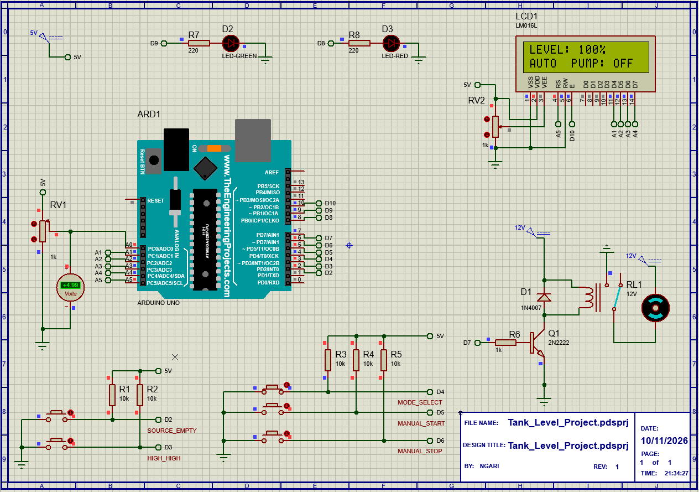

# Smart Water Tank Monitoring and Automatic Pump Controller

## Project Overview

An embedded system designed to monitor water levels and automatically control a water pump while providing manual operation and safety protection.

## Hardware and Software

- ATmega328P / Arduino Uno
- 16x2 LCD (LM016L)
- Analogue water-level sensor
- Digital safety switches
- Relay-controlled pump output
- Status LEDs
- Proteus 8
- PlatformIO
- AVR C

## Features

- Real-time water-level monitoring
- Automatic pump control
- Manual START/STOP control
- Source-empty protection
- High-level protection
- LCD status display
- UART monitoring
- Modular C firmware architecture

## Firmware Architecture

The firmware is divided into independent modules:

- ADC driver
- GPIO driver
- Timer driver
- LCD driver
- UART terminal driver
- Pump controller application

## Simulation

The circuit was designed and tested in Proteus 8.

### Circuit Diagram

## Building the Firmware

1. Open the project in VS Code with PlatformIO installed.
2. Select the Arduino Uno / ATmega328P environment.
3. Build the project.
4. Load the generated HEX file into the Proteus simulation.

## Author

David Ngari
